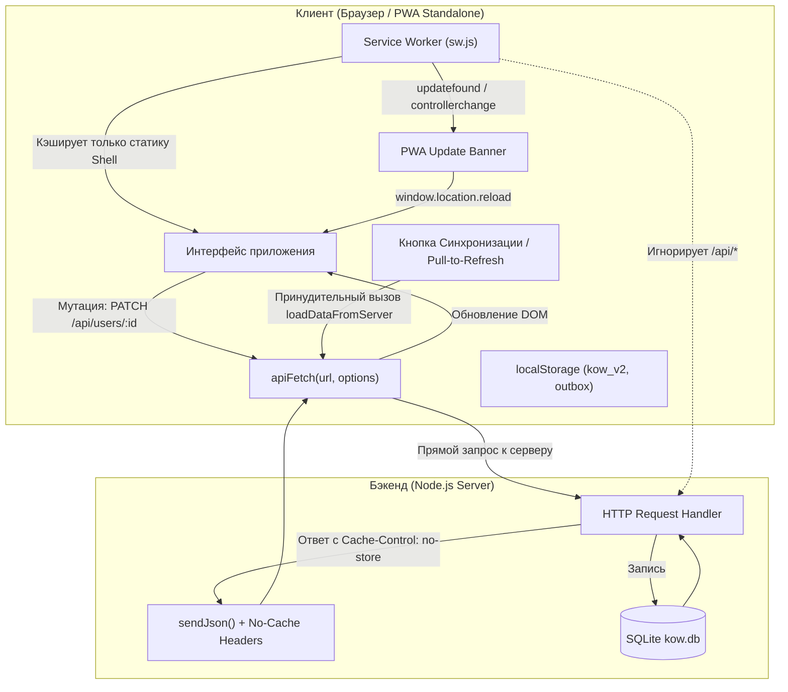

# Техническое задание (ТЗ): Инвалидация кэша, живая синхронизация данных и жизненный цикл PWA (Live Sync & Cache Control)

- **Дата составления**: 2026-11-06
- **Статус**: На согласовании (Draft)
- **Область изменений**: `server.js`, `sw.js`, `app.js`, `index.html`, `style.css`, `api.test.js`, `i18n.js`

---

## 1. Введение и бизнес-цель

### 1.1. Проблематика
В текущей версии KoW Tracker обнаружена проблема: при изменении данных на клиенте (например, сохранении прав доступа пользователя через `PATCH /api/users/:id`) изменения не отображаются на странице «Пользователи и права». Данные появляются только после жесткой перезагрузки страницы комбинацией `Cmd + Shift + R`.

Причины проблемы:
1. **Отсутствие HTTP-заголовков управления кэшем на бэкенде**: `sendJson` в `server.js` не передает директивы `Cache-Control`, что позволяет браузерам (Chrome, Safari/WebKit) использовать эвристический дисковый/оперативный кэш (RFC 7234).
2. **Отсутствие директивы `cache: 'no-store'` в клиентском `apiFetch`**: Браузер использует режим по умолчанию (`cache: 'default'`) и при повторном вызове `fetch('/api/users')` возвращает закешированный JSON.
3. **PWA Standalone уязвимость**: Пользователи, установившие сервис на рабочий стол или смартфон как PWA-приложение, **не имеют адресной строки, кнопки обновления и клавиатурной комбинации `Cmd + Shift + R`**. При залипании кэша PWA-клиент оказывается в безвыходном состоянии без возможности принудительно обновить данные.
4. **Зависание версии в Service Worker**: В `sw.js` зафиксирован `CACHE_NAME = 'kow-cache-v3.31.0'`, в то время как проект уже на версии `v3.37.1`. В коде нет механизмов отслеживания новых версий и уведомления пользователя о необходимости обновления.

### 1.2. Цели реализации
- Гарантировать мгновенное и актуальное отображение данных после любых мутаций (права, роли, офицеры, ивенты, склады) без перезагрузки страницы.
- Исключить кэширование динамических API-запросов на стороне браузера и WebView.
- Предоставить пользователям PWA (на смартфонах и ПК) удобные и естественные способы обновления данных прямо из интерфейса приложения.
- Сохранить **100% автономность (Offline-first)**: оболочка приложения, просмотр сохраненных данных, локальный калькулятор и отложенная очередь мутаций (`outboxQueue`) должны функционировать без сбоев при полном отсутствии интернета.
- Внедрить автоматическое обнаружение обновлений приложения с ненавязчивым всплывающим баннером.

---

## 2. Архитектура решения и компоненты



---

## 3. Детальные требования по модулям

### Модуль 1: Антикэширование динамических API (HTTP Cache Control)

#### 1.1. Бэкенд (`server.js`)
В функции `sendJson(res, statusCode, data)` внедрить строгие антикэш-заголовки для всех динамических API-эндпоинтов:
```javascript
function sendJson(res, statusCode, data) {
  const json = JSON.stringify(data);
  res.writeHead(statusCode, {
    'Content-Type': 'application/json; charset=utf-8',
    'Cache-Control': 'no-store, no-cache, must-revalidate, proxy-revalidate, max-age=0',
    'Pragma': 'no-cache',
    'Expires': '0',
    'Surrogate-Control': 'no-store',
    'Access-Control-Allow-Origin': '*',
    'Access-Control-Allow-Methods': 'GET, POST, PUT, PATCH, DELETE, OPTIONS',
    'Access-Control-Allow-Headers': 'Content-Type, Authorization, Cache-Control, Pragma'
  });
  res.end(json);
}
```
*Исключение:* Эндпоинт скриншотов аудита складов (`GET /api/screenshots/:filename`) сохраняет кэширование `Cache-Control: private, max-age=86400`, так как файлы скриншотов иммутабельны (содержимое не меняется после загрузки).

#### 1.2. Клиент (`app.js`)
1. В функции `apiFetch(url, options)`:
   - Для всех запросов по умолчанию устанавливать сетевой режим:
     ```javascript
     const fetchOptions = {
       ...options,
       cache: 'no-store',
       headers: {
         'Pragma': 'no-cache',
         'Cache-Control': 'no-cache',
         ...(options.headers || {})
       }
     };
     ```
2. В функциях мутации пользователей:
   - В `submitUserPermissions`:
     - Оптимистично обновить `userInCache.permissions = selected` в памяти.
     - Дождаться выполнения `PATCH /api/users/:userId`.
     - При вызове `await renderUsers()` гарантировать получение свежих данных.
   - В `handleChangeUserRank`:
     - Добавить обновление `userInCache.rank = newRank` в локальном кэше и автоматический вызов `await renderUsers()` при успехе (сейчас `renderUsers` вызывался только в блоке `catch`).
   - В `handleToggleBlockUser`:
     - Аналогично обновлять `is_blocked` и перерисовывать таблицу пользователей без задержек.

---

### Модуль 2: Управление версиями Service Worker и баннер обновления PWA

#### 2.1. Актуализация Service Worker (`sw.js`)
1. Синхронизировать версию кэша с актуальной версией проекта:
   `const CACHE_NAME = 'kow-cache-v3.38.0';`
2. Обеспечить корректный жизненный цикл:
   - В событии `install`: предварительное кэширование `STATIC_ASSETS` и немедленный переход в активную фазу `self.skipWaiting()`.
   - В событии `activate`: удаление всех старых кэшей (`key !== CACHE_NAME`) и немедленный перехват управления клиентами `self.clients.claim()`.
   - В событии `fetch`: запросы `/api/*` строго пропускаются в сеть (`return`), кэшируется только статическая оболочка (App Shell).

#### 2.2. Детектор обновлений в клиенте (`app.js`)
1. При регистрации Service Worker:
   ```javascript
   navigator.serviceWorker.register('/sw.js').then(reg => {
     // Проверка обновлений при запуске
     reg.addEventListener('updatefound', () => {
       const newWorker = reg.installing;
       newWorker.addEventListener('statechange', () => {
         if (newWorker.state === 'installed' && navigator.serviceWorker.controller) {
           showPwaUpdatePrompt();
         }
       });
     });
   });
   ```
2. Периодическая проверка: вызов `reg.update()` раз в 60 минут и при событии `document.visibilitychange` (когда вкладка становится активной).
3. При смене контроллера (`navigator.serviceWorker.addEventListener('controllerchange')`): автоматическое применение или готовность к перезагрузке.

#### 2.3. UI баннера обновления (`index.html`, `style.css`)
- Создать компактный плавающий баннер в нижней части экрана:
  ```html
  <div id="pwa-update-banner" class="pwa-update-banner" style="display:none">
    <div class="pwa-update-content">
      <span class="pwa-update-icon">🚀</span>
      <span class="pwa-update-text" data-i18n="pwa.update_available">Доступно обновление приложения</span>
    </div>
    <div class="pwa-update-actions">
      <button class="btn-primary btn-sm" onclick="applyAppUpdate()" data-i18n="pwa.btn_refresh">Обновить</button>
      <button class="btn-ghost btn-sm" onclick="dismissAppUpdate()">✕</button>
    </div>
  </div>
  ```
- Стилизация: адаптивная плашка с мягкой тенью и плавной анимацией появления.

---

### Модуль 3: Механизмы синхронизации в интерфейсе PWA

#### 3.1. Кнопка глобальной синхронизации в Topbar
- В шапку (`.topbar-right`) рядом с профилем и переключателем языков добавить кнопку быстрой синхронизации данных:
  ```html
  <button id="btn-global-sync" class="btn-icon-topbar" onclick="handleGlobalSync()" title="Синхронизировать данные">
    <span class="sync-icon">🔄</span>
  </button>
  ```
- Логика работы `handleGlobalSync()`:
  1. Добавляет класс анимации вращения `.spinning` на иконку.
  2. Вызывает `await loadDataFromServer()`.
  3. Если текущая страница — `users`, вызывает `renderUsers()`.
  4. Если текущая страница — `my_cabinet`, вызывает `renderMyCabinet()`.
  5. Для остальных страниц перерисовывает активный экран через `navigate(currentPage, pageParams)`.
  6. Снимает класс анимации и показывает аккуратный тост: *«Данные актуализированы»* (`t('toasts.sync_success')`).

#### 3.2. Тихая фоновая синхронизация (Silent Refresh)
- При возвращении пользователя в приложение после переключения задач:
  ```javascript
  let lastSyncTime = Date.now();
  document.addEventListener('visibilitychange', () => {
    if (document.visibilityState === 'visible') {
      const now = Date.now();
      // Если прошло более 3 минут с последней синхронизации
      if (now - lastSyncTime > 3 * 60 * 1000 && navigator.onLine) {
        lastSyncTime = now;
        loadDataFromServer().then(() => {
          refreshCurrentPage();
        }).catch(() => {});
      }
    }
  });
  ```

#### 3.3. Мобильный Pull-to-Refresh
- Для мобильных экранов (touch-устройства): добавить обработку свайпа вниз в начале страницы с индикатором натяжения и вызовом `handleGlobalSync()`.

---

### Модуль 4: Сохранение 100% автономности (Offline Guarantee)

1. **Гарантия работы без сети**:
   - При `navigator.onLine === false` или сетевой ошибке вызов `apiFetch` гарантированно перенаправляется в `handleOfflineApiRequest`.
   - Запрет кэширования `cache: 'no-store'` распространяется исключительно на сетевые вызовы. Офлайн-обработчик возвращает данные из локального `state` и `localStorage` без сбоев.
2. **Очередь мутаций (`outboxQueue`)**:
   - Любые изменения в личном кабинете при отсутствии сети продолжают сохраняться в `kow_outbox_queue`.
   - При восстановлении события `'online'` очередь автоматически отправляется на сервер (`flushOutboxQueue()`).

---

### Модуль 5: Мультиязычность (i18n)

Добавить ключи переводов в `i18n.js` для всех трех языков (`ru`, `en`, `de`) со 100% паритетом:
- `pwa.update_available`:
  - `ru`: "Доступно обновление приложения"
  - `en`: "An application update is available"
  - `de`: "Ein Anwendungsupdate ist verfügbar"
- `pwa.btn_refresh`:
  - `ru`: "Обновить"
  - `en`: "Update"
  - `de`: "Aktualisieren"
- `toasts.sync_success`:
  - `ru`: "Данные успешно синхронизированы"
  - `en`: "Data successfully synchronized"
  - `de`: "Daten erfolgreich synchronisiert"
- `common.sync`:
  - `ru`: "Синхронизировать"
  - `en`: "Synchronize"
  - `de`: "Synchronisieren"

---

## 4. План тестирования (TDD и верификация)

1. **Модульные тесты заголовков API (`api.test.js`)**:
   - Проверка наличия заголовков `Cache-Control: no-store...` и `Pragma: no-cache` в ответах `GET /api/users`, `GET /api/events`, `GET /api/catalog`, `GET /api/players`.
   - Проверка иммутабельности скриншотов: `GET /api/screenshots/:filename` сохраняет `Cache-Control: private, max-age=86400`.
2. **Интеграционные тесты мутаций (`api.test.js`)**:
   - Сценарий: изменение прав через `PATCH /api/users/:id` -> последующий запрос `GET /api/users` немедленно возвращает актуальные права.
   - Сценарий: смена ранга через `PATCH /api/users/:id` -> немедленное отражение в базе.
3. **Тесты Service Worker (`sw.js`)**:
   - Проверка структуры `STATIC_ASSETS`.
   - Проверка очистки устаревших кэшей в обработчике `activate`.
4. **Тесты мультиязычности (`i18n.test.js`)**:
   - 100% паритет ключей `pwa` и `sync` во всех словарях.
5. **Сквозная проверка синтаксиса**:
   - `node -c server.js sw.js app.js logic.js i18n.js`
   - Полный прогон `npm test`.

---

## 5. Методология GitFlow

Все работы будут выполнены строго в соответствии с GitFlow:
1. Создание рабочей ветки: `bugfix/pwa-cache-and-live-sync` от актуального состояния `main`.
2. Разработка по TDD (красный тест -> зеленый код -> рефакторинг).
3. Создание релизной ветки: `release/v3.38.0`.
4. Обновление версии в `package.json`, `app.js` (`APP_VERSION`), `sw.js` (`CACHE_NAME`) и фиксация в `CHANGELOG.md`.
5. Слияние в `main` через `git merge --no-ff release/v3.38.0` с аннотированным тегом `v3.38.0`.
